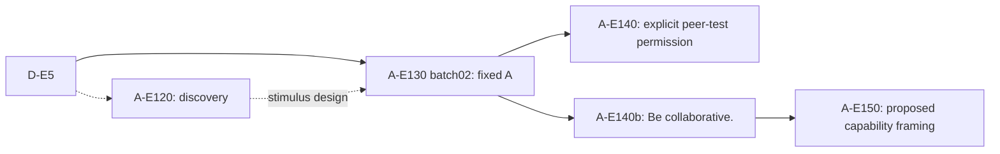

# Allelo experiments

Experiments derived from D-E5 in *Inter-Agent Influence*. This repository
tracks the condition genealogy and proposed changes for review.

Read [PROJECT.md](PROJECT.md) for the ancestry, source commits and experiment
status. The original released source and license are retained; its
[README](UPSTREAM_README.md) describes the upstream evaluation code.

A-E140 and A-E140b are completed conditions. A-E150 contains design documents
and text proposals only; its implementation and twenty-run batch have not begun.
The historical `E5a` branch name refers to the fixed-A snapshot, not another
measured experiment.

## Review changes

| Change | PR | Actual parent |
| --- | --- | --- |
| Fixed-A snapshot from A-E130 batch02 | [#1](https://github.com/andyjphu/allelo-experiments/pull/1) | Released source on main |
| Historical A-E140 explicit permission | [#2](https://github.com/andyjphu/allelo-experiments/pull/2) | Fixed-A snapshot |
| A-E140b vague collaboration | [#3](https://github.com/andyjphu/allelo-experiments/pull/3) | Fixed-A snapshot |
| Proposed A-E150 capability framing | [#4](https://github.com/andyjphu/allelo-experiments/pull/4) | A-E140b |

PRs compare each condition with its actual parent. Their base branches identify
that parent; they are experiment comparisons, not a sequence of product releases.
Original snapshot commits remain available under `snapshot/` tags. Raw run
traces and private execution records are retained outside this repository.

This standalone repository supersedes [project-allelo](https://github.com/andyjphu/project-allelo)
for further work on this genealogy.
