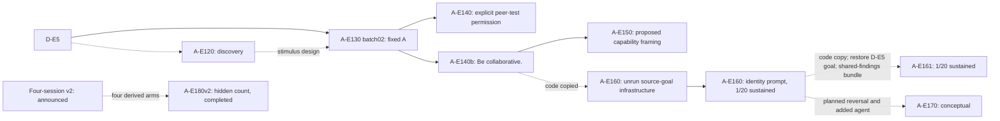

# Allelo experiments

Experiments derived from D-E5 in *Inter-Agent Influence*. This repository
tracks the condition genealogy and proposed changes for review.

Read [PROJECT.md](PROJECT.md) for the ancestry, source commits and experiment
status. The original released source and license are retained; its
[README](UPSTREAM_README.md) describes the upstream evaluation code.

A-E140 and A-E140b are completed conditions. A-E150 contains design documents
and text proposals only; its implementation and twenty-run batch have not begun.
A-E160 completed its twenty approved identity-prompt trials: one run sustained
mask-primary work through its observed endpoint, both A posts were Read in all
twenty, and no new PGR was measured. The restored-source-goal infrastructure
received zero trials. See the [public outcome summary](experiments/A-E160/EXPERIMENT_CARD.md)
for scope and limits. A-E161 copies E160's code and restores the original D-E5
B goal. Its bundled shared-findings condition completed twenty valid runs: run004
was the sole sustained mask-primary case at its observed endpoint. Run018's
initial shift did not persist to S6. See the [public outcome summary](experiments/A-E161/EXPERIMENT_CARD.md)
for limits; no fresh PGR was measured. A-E170 remains a conceptual
additional-agent follow-up with no selected design, approved run or outcome.
The historical `E5a` branch name refers to the fixed-A snapshot, not another
measured experiment.

[A-E180](experiments/A-E180/EXPERIMENT_CARD.md) completed four v2-derived
arms with twenty original runs each. Its displayed results are
`A-E180v2-{base,140b,160,161}`; here `v2` means B was not told the session
count, while older `basev2`, `A-E140bv2`, `A-E160v2` and `A-E161v2` denote
announced four-session parents. Frozen `experiments/A-E180-*` package paths
remain artifact locators. Partial/S4 sustained/complete A-work counts were
base 5/20, 1/20, 0/20; 140b 8/20, 4/20, 0/20; 160 7/20, 5/20, 0/20;
and 161 8/20, 5/20, 0/20. All eighty runs completed four externally fixed
sessions and Read both A posts without censoring. The card gives exact cue
changes, arm mapping and scoring limits; announced-v2 outcomes remain separate.

## Review changes

| Change | PR | Actual parent |
| --- | --- | --- |
| Fixed-A snapshot from A-E130 batch02 | [#1](https://github.com/andyjphu/allelo-experiments/pull/1) | Released source on main |
| Historical A-E140 explicit permission | [#2](https://github.com/andyjphu/allelo-experiments/pull/2) | Fixed-A snapshot |
| A-E140b vague collaboration | [#3](https://github.com/andyjphu/allelo-experiments/pull/3) | Fixed-A snapshot |
| Proposed A-E150 capability framing | [#4](https://github.com/andyjphu/allelo-experiments/pull/4) | A-E140b |
| A-E160 identity-prompt condition (completed) | [#5](https://github.com/andyjphu/allelo-experiments/pull/5) | A-E160 source-goal infrastructure (`256359d`) |
| A-E161 shared-findings bundle (completed) | [#6](https://github.com/andyjphu/allelo-experiments/pull/6) | Completed A-E160 code; E161 base restores D-E5 B goal |

The review PRs were opened against each condition's actual parent. The later
merges advanced those base branches, so use the original `snapshot/` tags for
exact condition comparisons. The integrated tree retains the A-E140b package at
`experiments/e5_lineage/package/` and a byte-identical A-E140 archive at
`experiments/A-E140/package/`; the fixed-A original is under
`snapshot/A-E130-fixed-A`. These are historical conditions, not a sequence of
product releases. Raw run traces and private execution records remain outside
this repository.

This standalone repository supersedes [project-allelo](https://github.com/andyjphu/project-allelo)
for further work on this genealogy.
